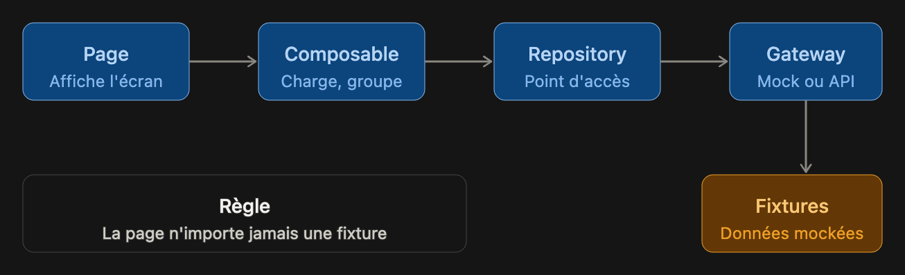

## Ce qu'on appelle une donnée mockée

Une **donnée mockée** (ou factice, simulée) est une fausse donnée qui imite ce que renverrait une vraie source, par exemple une API. On parle aussi de **mock** pour le faux service, et de **fixture** pour le jeu de données de démo ou de test.

Dans le projet :

- les **fixtures** (`fixtures/slots`, `fixtures/appointment`…) contiennent les données factices ;
- le **mock gateway** (`createMockGateway`) renvoie ces données comme le ferait le serveur ;
- le **repository** et les **mappers** transforment ces données en objets utilisés par l'application.

**Le but :** développer l'interface sans serveur, puis passer au vrai serveur en ne changeant que la gateway.

## La chaîne de données



:::caution[Règle]
La page n'importe **jamais** une fixture. Les fixtures ne vivent qu'au niveau de la gateway.
:::

**Ce qui est interdit :**

```ts
// Dans la page ou un composant : interdit
import { slotsFixture } from '@/api/gateways/mock/fixtures/slots'
const creneaux = slotsFixture()
```

La page relie alors directement son affichage aux données factices. Quand le vrai serveur arrive, il faut réécrire la page, et tant que ce n'est pas fait, elle continue d'afficher du faux.

**Ce qui est attendu :**

```ts
// Dans le composable : OK
const creneaux = await repository.listerCreneaux(DOSSIER_COURANT_ID)
```

Pour le détail de chaque couche et le choix entre mock et API réelle, voir [Architecture et organisation](../architecture/#architecture-en-couches).

## La métaphore du restaurant

| Rôle | Métaphore | Ce qu'il fait |
|---|---|---|
| **Page** | Le client au restaurant | Il regarde ce qu'on lui sert et choisit, mais il ne cuisine pas et ne sait pas d'où viennent les ingrédients. |
| **Composable** | Le chef de salle | Il récupère la commande, trie, regroupe et prépare ce qui doit être montré au client (ici, les créneaux par jour). |
| **Repository** | L'accueil du bâtiment | Il reçoit les demandes (`listerCreneaux`, `obtenirDossier`) sans dire qui va les chercher. |
| **Gateway** | Le livreur | Il va chercher la marchandise là où elle se trouve. |
| **Mapper** | Le cuisinier | Il met les produits bruts du fournisseur en forme pour le menu : il transforme le format du serveur en format de l'application (`toCreneau`, `toDossier`). |
| **Fixture** | Les faux plats en plastique de la vitrine | Ils ressemblent à de vrais plats, mais servent à tester sans cuisine. |
| **Mock gateway** | Le livreur qui n'apporte que les faux plats de la vitrine | Pour travailler sans fournisseur. |
| **API réelle** | Le livreur qui passe chez le vrai fournisseur | Pour l'application, c'est le même travail : seul le trajet change. |
| **Types du domaine** (`Creneau`, `Dossier`) | La fiche standard du menu | Tout le monde, du cuisinier à la salle, l'utilise pour parler du même plat. |

## Conseils pour l'intégrer

### 1. Dessine la chaîne avant de coder

Page → composable → repository → gateway → (mock ou HTTP). Les fixtures ne vivent qu'au niveau de la gateway. Si une page ou un composant importe une fixture, la couche est mauvaise.

### 2. Commence par la donnée, pas par l'écran

Ouvre la fixture et le type du domaine (`Creneau`, `Dossier`…). Note les noms de champs exacts (`SlotStart`, `debut`…). Beaucoup de bugs viennent d'un écart entre le nom attendu et le nom réel.

### 3. Affiche la donnée brute avant de construire l'interface

Un `console.log` dans le composable, ou une simple liste, montre la forme réelle :

```vue
<pre>{{ jours }}</pre>
```

Tu vois ce qui manque (heures, jours, doublons) avant de toucher au style.

### 4. La maquette est une référence visuelle, les fixtures sont la vérité des données

Les heures d'une maquette sont souvent inventées. Ce qui compte pour le code, c'est ce que renvoie la donnée.

### 5. Fais le test de la bascule

Demande-toi : « Si je remplace le mock par la vraie API, est-ce que je dois modifier un composant ? » Si oui, une couche est mal placée.

### 6. Pose des questions précises

Plutôt que « ça ne marche pas », donne le chemin du fichier, ce que tu attends et ce que tu vois. Par exemple : « `useCreneaux` reçoit bien 12 créneaux, mais `jours` est vide. »
